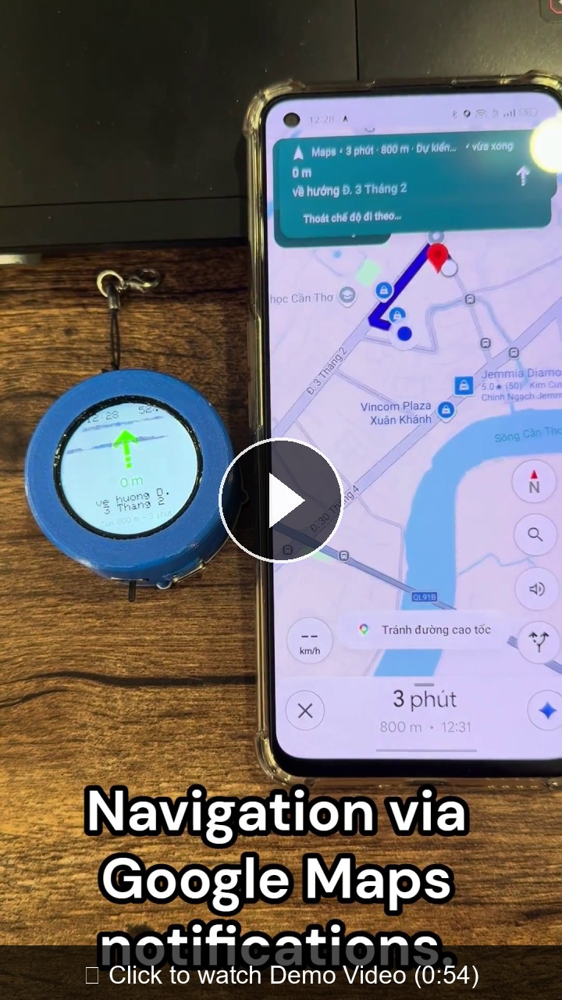
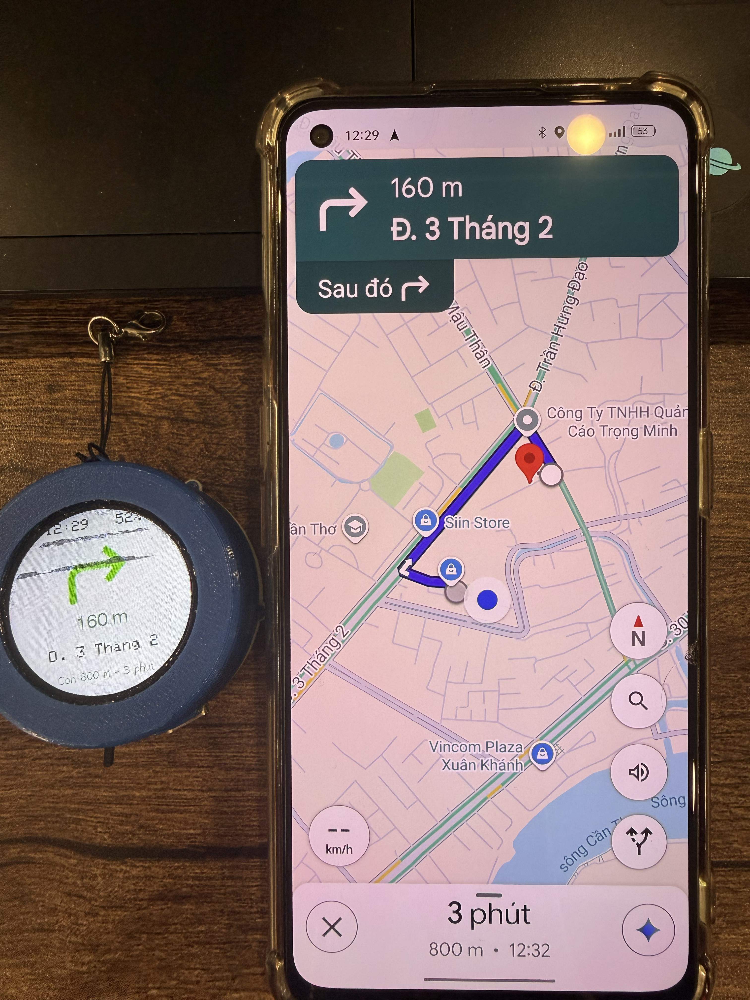
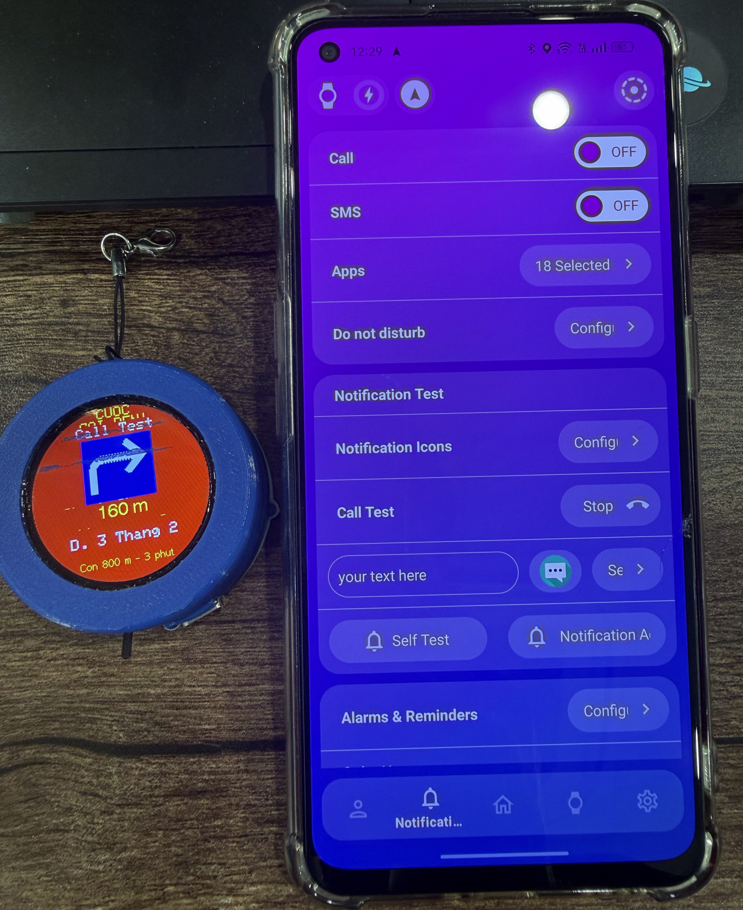
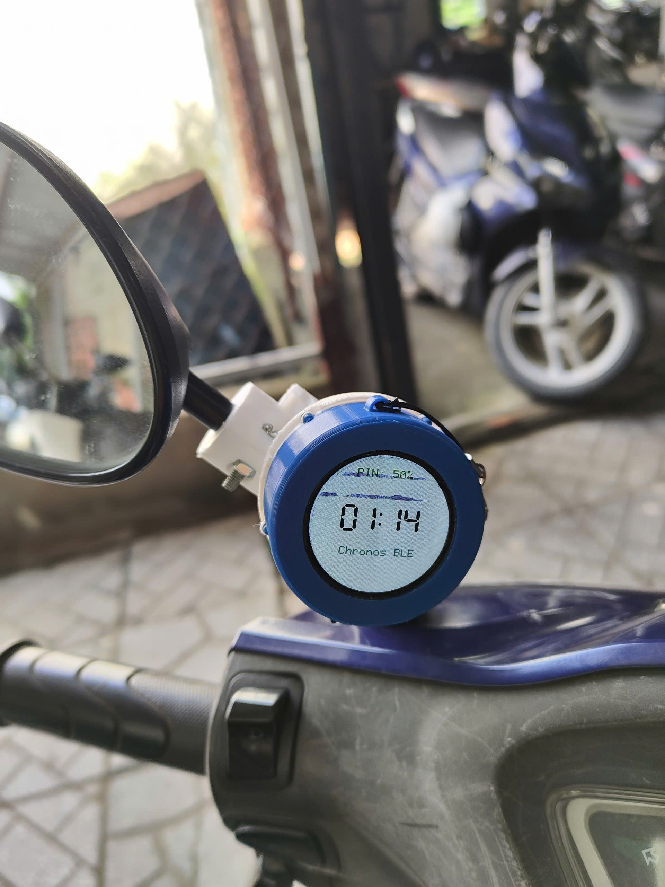
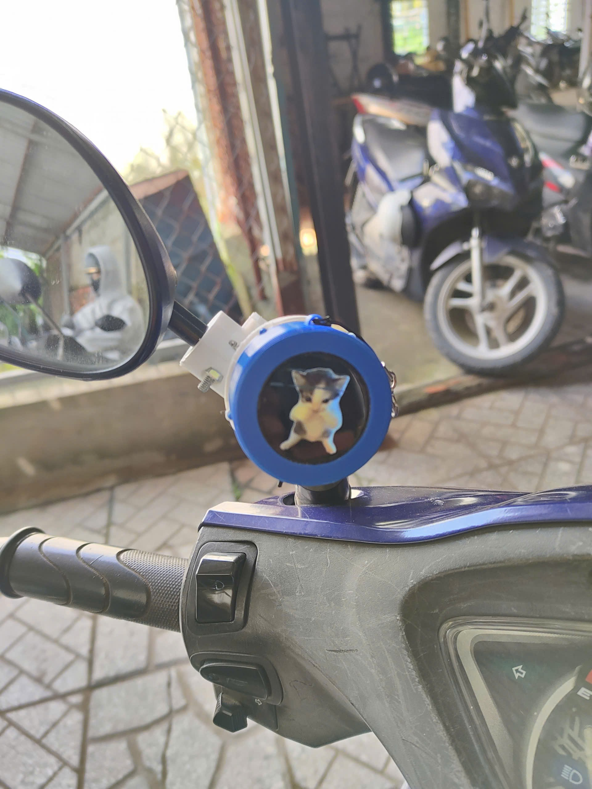
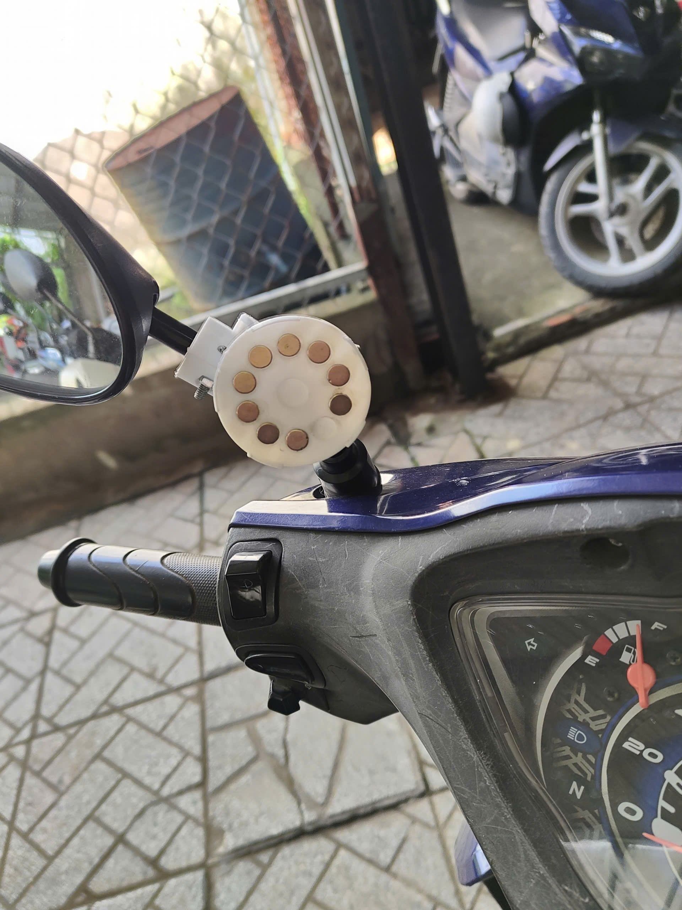
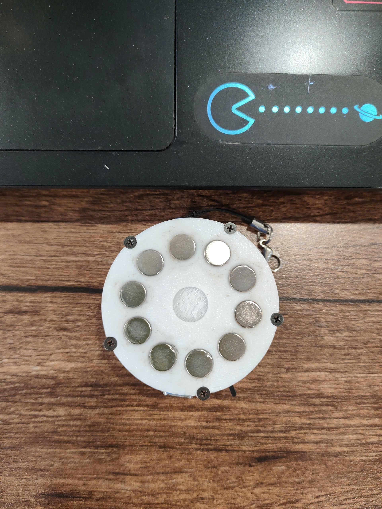

# 🧭 ESP32-C3 Round Smart Display: Google Maps Navigation with Chronos

[](https://platformio.org/)
[](https://www.espressif.com/)
[](#-phần-cứng--sơ-đồ-nối-dây-hardware--wiring)
[](LICENSE)

[🇻🇳 Tiếng Việt](#-tiếng-việt) | [🇬🇧 English](#-english)

---

# 🇻🇳 Tiếng Việt

Thiết bị hiển thị thông minh dạng màn hình tròn (gắn ghi-đông xe máy/xe đạp), sử dụng vi điều khiển **ESP32-C3** kết hợp với **màn hình tròn TFT LCD 1.28 inch (GC9A01, độ phân giải 240x240)**. 

Thiết bị giao tiếp không dây với điện thoại Android qua **Bluetooth Low Energy (BLE)** thông qua ứng dụng **Chronos**, hiển thị trực tiếp dữ liệu chỉ đường theo thời gian thực từ **Google Maps**, thông báo cuộc gọi đến nổi bật, và phát hoạt ảnh GIF sinh động khi ở chế độ chờ.

---

## 📸 Demo & Hình ảnh thực tế

<div align="center">

### 🎬 Video Demo hoạt động thực tế (~1 phút)

[](docs/images/Demo.mp4)

*👉 **[Bấm vào đây (hoặc bấm vào hình trên) để xem toàn bộ Video Demo trên GitHub](docs/images/Demo.mp4)***

</div>

> ⚠️ **Lưu ý về hình ảnh thực tế:**
> Vết sọc đen ngang trên màn hình trong ảnh chụp và video demo là do trong lúc sử dụng tôi bất cẩn để vật nặng đè lên làm cấn nứt LCD phần cứng, hoàn toàn **không phải lỗi phần mềm hay code hiển thị**.

| Dẫn đường thời gian thực trên xe | Cảnh báo cuộc gọi đến |
| :---: | :---: |
|  |  |

| Lắp đặt thực tế trên chân gương | Góc nhìn của người lái |
| :---: | :---: |
|  |  |

| Ngàm đế gắn ghi-đông (10 nam châm tròn) | Mặt lưng hộp thiết bị (10 nam châm tròn) |
| :---: | :---: |
|  |  |

---

## ✨ Tính năng nổi bật

- 🗺️ **Giao diện Dẫn đường Google Maps thời gian thực**:
  - Mũi tên chỉ hướng rẽ kích thước lớn $96\times96\text{px}$.
  - Khoảng cách đến khúc rẽ tiếp theo / Hành động rẽ (ví dụ: `200 m`, `Rẽ phải`).
  - Tên tuyến đường tiếp theo (tự động ngắt dòng thông minh khi tên đường dài).
  - Quãng đường tổng còn lại & Thời gian di chuyển đến đích (ví dụ: `Còn 12 km - 18 ph`).
- ⭕ **Thiết kế tối ưu cho màn hình tròn (240x240)**:
  - Phân chia các Zone tọa độ hiển thị độc lập, không bị lẹm hay tràn ra ngoài viền kính cong.
- 🔤 **Bộ khử dấu tiếng Việt & Lọc Emoji chuyên dụng**:
  - Bảng tra chuẩn 134 ký tự tiếng Việt nguyên bản, chuyển đổi chính xác mọi dấu câu sang ASCII chuẩn (ví dụ: `Về hướng Đ. Ng. Sĩ Liên` $\to$ `Ve huong D. Ng. Si Lien`).
  - Tích hợp kiểm tra nhanh, bỏ qua tra bảng khi gặp chuỗi số/chữ tiếng Anh giúp tiết kiệm tối đa chu kỳ CPU.
  - Tự động lọc sạch Emoji và ký tự ngoài chuẩn ASCII, tránh tràn bộ đệm hiển thị.
- 📞 **Cảnh báo cuộc gọi đến rực rỡ**:
  - Tự động chuyển toàn bộ màn hình sang màu đỏ cảnh báo kèm tên người gọi đến.
  - Mũi tên chỉ đường tự động đảo màu sang trắng sáng trên nền đỏ, giúp người lái xe vừa biết có cuộc gọi vừa không bị lạc hướng.
- 🎞️ **Phát Random 3 GIF ở chế độ chờ (Standby)**:
  - Nạp sẵn 3 hình ảnh động GIF $240\times240$ vào bộ nhớ Flash.
  - Sử dụng bộ random của ESP32 (`esp_random()`) để chọn ngẫu nhiên 1 GIF khi mở nguồn và mỗi lần mất kết nối BLE.
- ⚡ **Cơ chế BLE Keep-Alive**:
  - ESP32 chủ động gửi gói tin ping định kỳ lên điện thoại, ngăn chặn Android tắt tiến trình chạy ngầm của App Chronos khi chạy đường dài.

---

## 🛠️ Phần cứng & Sơ đồ nối dây (Hardware & Wiring)

### 1. Danh sách linh kiện sử dụng:
- **Board điều khiển**: ESP32-C3 DevKit (Flash 4MB, kiến trúc RISC-V).
- **Màn hình hiển thị**: TFT LCD tròn 1.28 inch (GC9A01, độ phân giải 240x240, giao tiếp SPI).
  > **⚠️ Lưu ý gia công vỏ in 3D:** Phần rìa mạch PCB thừa ở cạnh màn hình cần được cắt/mài bớt một chút để lắp vừa vặn vào bên trong vỏ in 3D.
- **Pin nguồn**: [Pin tép Li-Po 3.7V 800mAh (mã 703040)](https://shopee.vn/Pin-t%C3%A9p-3.7V-800mAh-703040-d%C3%B9ng-cho-loa-Bluetooth-%C4%90%E1%BB%8Bnh-v%E1%BB%8B-GPS-Camera-h%C3%A0nh-tr%C3%ACnh-i.853237848.26031892378) chuyên dụng cho loa Bluetooth, định vị GPS, camera hành trình.
- **Công tắc nguồn**: [Công tắc gạt 3 chân 2 vị trí (SPDT Slide Switch)](https://shopee.vn/-Linh-Ki%E1%BB%87n-%C4%90i%E1%BB%87n-T%E1%BB%AD-G226-Combo-5-Chi%E1%BA%BFc-C%C3%B4ng-T%E1%BA%AFc-G%E1%BA%A1t-3-Ch%C3%A2n-2-V%E1%BB%8B-Tr%C3%AD-i.1774297521.48868485996) nối tiếp với dây dương (+) từ pin vào chân 5V của ESP32.
- **Mạch sạc pin**: [Mạch sạc pin Lithium TP4056 có IC bảo vệ cổng Type-C](https://shopee.vn/M%E1%BA%A1ch-s%E1%BA%A1c-pin-TP4056-c%C3%B3-IC-b%E1%BA%A3o-v%E1%BB%87-c%E1%BB%95ng-type-C-USB-i.51294060.22256123109).
- **Bộ cổng nối dài Type-C đa năng**: [Bộ đầu nối chuyển đổi USB 3.1 Type-C đực/cái sang chân hàn](https://shopee.vn/B%E1%BB%99-10-%C4%90%E1%BA%A7u-N%E1%BB%91i-Chuy%E1%BB%83n-%C4%90%E1%BB%95i-USB-3.1-Type-C-%C4%90%E1%BB%B1c-C%C3%A1i-Sang-D%C3%A2y-C%C3%A1p-H%C3%A0n-24-Ch%E1%BA%A5u-i.1017683881.18280936728) gồm 1 đầu cái gắn lộ ra ngoài vỏ và 1 đầu đực cắm vào ESP32-C3.
- **Nam châm hít giữ ngàm tháo lắp nhanh**: 20 viên nam châm vĩnh cửu Neodymium tròn đường kính Ø8mm (gồm 10 viên gắn âm vào nắp lưng hộp và 10 viên gắn đối xứng vào đế kẹp ghi-đông, giúp cố định thiết bị cực kỳ chắc chắn, chống rung lắc khi đi xe và tháo lắp nhanh chóng bằng tay).

### 2. Sơ đồ khối cấp nguồn & truyền dữ liệu:
```
[ Cổng Type-C lộ ngoài vỏ ]
  ├── Đường nguồn VBUS (+), GND (-) ───> [ Mạch sạc TP4056 ]
  │                                           └── Ngõ B+, B- ───> [ Pin Li-Po 3.7V 800mAh ]
  │                                                                    │
  │                                                              (Dây dương +)
  │                                                                    │
  │                                                            [ Công tắc gạt ]
  │                                                                    │
  │                                                                    ▼
  │                                                             Chân 5V (VIN)
  └── Đường dữ liệu Data+ (D+), Data- (D-) ────────────────────> Chân D+, D- ──> [ ESP32-C3 ]
```

> **⚡ Lưu ý quan trọng khi nạp code (Flash Firmware):**
> - Cổng Type-C bên ngoài vỏ đảm nhiệm 2 chức năng đồng thời: vừa là cổng cắm sạc pin, vừa là cổng truyền dữ liệu để nạp code và debug Serial.
> - Do đường nguồn cấp cho ESP32 đi qua công tắc pin, **khi cắm cáp kết nối máy tính để nạp code, bạn bắt buộc phải BẬT CÔNG TẮC NGUỒN PIN** thì ESP32 mới được cấp điện và máy tính mới nhận diện được cổng COM.

### 3. Bảng kết nối chân màn hình (Display Pinout):

| Chân Màn Hình (TFT) | Chân ESP32-C3 | Chức Năng |
| :--- | :--- | :--- |
| **VCC** | `3.3V` | Nguồn cấp 3.3V |
| **GND** | `GND` | Nối đất (Ground) |
| **SCL / SCLK** | `GPIO 6` | SPI Clock |
| **SDA / MOSI** | `GPIO 7` | SPI MOSI (Data In) |
| **CS** | `GPIO 10` | Chip Select |
| **DC** | `GPIO 5` | Data / Command |
| **RST / RES** | `GPIO 4` | Reset chân cứng |
| **BLK / BL** | `3.3V` (hoặc GPIO) | Đèn nền màn hình (Backlight) |

---

## 🖨️ Thiết kế & File in 3D (3D Printable Enclosure)

Repository đã chuẩn bị sẵn toàn bộ các file thiết kế 3D hoàn chỉnh trong thư mục [`FIle_in_3D/`](FIle_in_3D/), bạn chỉ cần nạp vào phần mềm cắt lát (Bambu Studio / PrusaSlicer / Cura) để in:

- **[`Hop.3mf`](FIle_in_3D/Hop.3mf)**: Thân hộp chính chứa màn hình GC9A01, bo mạch ESP32-C3, mạch sạc TP4056 và pin Li-Po 800mAh.
- **[`Nap_Ver2.3mf`](FIle_in_3D/Nap_Ver2.3mf)**: Nắp lưng hộp, tích hợp sẵn 10 khe gắn nam châm tròn Ø8mm để hít chặt vào đế gắn trên xe và lỗ luồn dây bảo hiểm.
- **[`De_VER2.3mf`](FIle_in_3D/De_VER2.3mf)**: Đế kẹp gắn ghi-đông / chân gương xe máy, chứa 10 vị trí gắn nam châm tròn Ø8mm đối xứng.
- **[`Van_Oc.3mf`](FIle_in_3D/Van_Oc.3mf)**: Núm ốc vặn tay ren để siết chặt ngàm kẹp vào ghi-đông hoặc chân gương xe máy một cách dễ dàng mà không cần cờ-lê.

---

## 📱 Cài đặt & Cấu hình Ứng dụng Android (Chronos)

1. Tải và cài đặt ứng dụng **Chronos** trên điện thoại Android ([Tải từ GitHub fbiego/chronos-esp32](https://github.com/fbiego/chronos-esp32) hoặc CH Play).
2. Mở app Chronos và cấp các quyền sau:
   - **Quyền truy cập thông báo (Notification Access):** Bắt buộc để ứng dụng đọc được thông báo dẫn đường của Google Maps.
   - **Quyền Bluetooth & Vị trí (Location).**
3. Trong cài đặt điện thoại Android:
   - **Tắt tối ưu hóa pin** cho ứng dụng Chronos (chọn *Không hạn chế* / *Unrestricted*).
   - Khóa ứng dụng trong màn hình Đa nhiệm (Recent Apps) để tránh Android tự động tắt ứng dụng chạy ngầm.
4. Quét tìm và kết nối với thiết bị BLE tên: `SmartWatch-ESP32`.
5. Bật dẫn đường trên **Google Maps** — màn hình ESP32 sẽ lập tức chuyển từ GIF sang màn hình dẫn đường sống động!

---

## 💻 Biên dịch & Nạp Code (PlatformIO)

### Thư viện sử dụng (PlatformIO tự động tải):
- [TFT_eSPI](https://github.com/Bodmer/TFT_eSPI)
- [AnimatedGIF](https://github.com/bitbank2/AnimatedGIF)
- [ChronosESP32](https://github.com/fbiego/chronos-esp32)

### Bảng phân vùng (Partition Setup):
Dự án sử dụng file cấu hình phân vùng `partitions_custom.csv` mở rộng bộ nhớ Flash dành cho ứng dụng lên **3.875 MB**, cho phép chứa trọn vẹn cả 3 file GIF $240\times240$ trực tiếp trong Flash của ESP32-C3 (4MB):

```csv
# Name,   Type, SubType, Offset,  Size, Flags
nvs,      data, nvs,     0x9000,  0x5000,
otadata,  data, ota,     0xe000,  0x2000,
app0,     app,  ota_0,   0x10000, 0x3E0000,
```

### Lệnh nạp firmware:

```bash
# Clone repository về máy
git clone https://github.com/<your-username>/ESP32C3-Google-Map-Navigation-Chronos.git
cd ESP32C3-Google-Map-Navigation-Chronos

# Biên dịch và nạp trực tiếp qua cổng COM
pio run -t upload --upload-port <CỔNG_COM_CỦA_BẠN>
```

---
---

# 🇬🇧 English

A smart round navigation display (mounted on motorcycle/bicycle handlebars) powered by an **ESP32-C3** and a **1.28-inch GC9A01 round TFT LCD (240x240)**. It pairs wirelessly with an Android smartphone via **Bluetooth Low Energy (BLE)** using the **Chronos** app to provide real-time Google Maps turn-by-turn navigation, prominent incoming call alerts, and vibrant animated GIF standby screens.

---

## 📸 Demo & Gallery

<div align="center">

### 🎬 Real-Life Demo Video (~1 minute)

[](docs/images/Demo.mp4)

*👉 **[Click here (or click the thumbnail above) to watch the full demo video on GitHub](docs/images/Demo.mp4)***

</div>

> ⚠️ **Note regarding real-life photos & demo:**
> The horizontal black streak visible across the circular LCD in the demo photos/video is physical hardware damage caused by accidental pressure from a heavy object on the glass. It is **not a software or rendering bug**.

| Real-Time Navigation Mounted on Bike | Incoming Call Alert |
| :---: | :---: |
|  |  |

| Motorcycle Mirror Stem Installation | Rider Cockpit View |
| :---: | :---: |
|  |  |

| Handlebar Mount (10 Neodymium Magnets) | Enclosure Backplate (10 Neodymium Magnets) |
| :---: | :---: |
|  |  |

---

## ✨ Features

- 🗺️ **Real-Time Google Maps Navigation Interface**:
  - Large $96\times96\text{px}$ turn maneuver arrow.
  - Distance to next turn / Next maneuver action (e.g., `200 m`, `Turn right`).
  - Next street name (smart automatic word-wrapping for long road names).
  - Total remaining distance & estimated travel time to destination (e.g., `12 km - 18 min`).
- ⭕ **Optimized for Circular Displays (240x240)**:
  - Independent coordinate zones prevent elements from clipping or overflowing outside the curved glass bezel.
- 🔤 **Dedicated Vietnamese Transliteration & Emoji Filter**:
  - Comprehensive 134-character lookup table converts Vietnamese diacritics to clean ASCII (e.g., `Về hướng Đ. Ng. Sĩ Liên` $\to$ `Ve huong D. Ng. Si Lien`).
  - Built-in fast check skips table lookup for English/numeric text to save CPU cycles.
  - Automatically strips emojis and non-standard ASCII characters to prevent display buffer overflow.
- 📞 **Prominent Incoming Call Alert**:
  - Screen turns bright red with caller name upon incoming call.
  - Turn arrow inverts to bright white on red background, helping riders notice calls without losing navigation direction.
- 🎞️ **Random 3-GIF Standby Mode**:
  - Preloads 3 full $240\times240$ animated GIFs directly into Flash memory.
  - Uses ESP32 random generator (`esp_random()`) to select a random GIF on boot and whenever BLE disconnects.
- ⚡ **BLE Keep-Alive Mechanism**:
  - ESP32 periodically sends ping packets to the phone, preventing Android from killing the Chronos app background process during long rides.

---

## 🛠️ Hardware & Pinout

### 1. Bill of Materials (Components):
- **Microcontroller**: ESP32-C3 DevKit (4MB Flash, RISC-V).
- **Display**: 1.28-inch Round TFT LCD (GC9A01, 240x240, SPI interface).
  > **⚠️ 3D Case Fitment Note:** The non-circuit margin of the display PCB needs to be trimmed/shaved slightly to fit snugly inside the 3D-printed enclosure.
- **Battery**: [3.7V 800mAh 703040 Li-Po Battery](https://shopee.vn/Pin-t%C3%A9p-3.7V-800mAh-703040-d%C3%B9ng-cho-loa-Bluetooth-%C4%90%E1%BB%8Bnh-v%E1%BB%8B-GPS-Camera-h%C3%A0nh-tr%C3%ACnh-i.853237848.26031892378) commonly used in Bluetooth speakers, GPS trackers, and dashcams.
- **Power Switch**: [3-Pin 2-Position SPDT Slide Switch](https://shopee.vn/-Linh-Ki%E1%BB%87n-%C4%90i%E1%BB%87n-T%E1%BB%AD-G226-Combo-5-Chi%E1%BA%BFc-C%C3%B4ng-T%E1%BA%AFc-G%E1%BA%A1t-3-Ch%C3%A2n-2-V%E1%BB%8B-Tr%C3%AD-i.1774297521.48868485996) connected in series with the battery positive (+) wire to the ESP32 5V pin.
- **Charger Module**: [TP4056 3.7V Lithium Battery Charger Module with Protection (Type-C)](https://shopee.vn/M%E1%BA%A1ch-s%E1%BA%A1c-pin-TP4056-c%C3%B3-IC-b%E1%BA%A3o-v%E1%BB%87-c%E1%BB%95ng-type-C-USB-i.51294060.22256123109).
- **Dual Type-C Power & Data Extension**: [USB 3.1 Type-C Male/Female Solder Connector Set](https://shopee.vn/B%E1%BB%99-10-%C4%90%E1%BA%A7u-N%E1%BB%91i-Chuy%E1%BB%83n-%C4%90%E1%BB%95i-USB-3.1-Type-C-%C4%90%E1%BB%B1c-C%C3%A1i-Sang-D%C3%A2y-C%C3%A1p-H%C3%A0n-24-Ch%E1%BA%A5u-i.1017683881.18280936728) (one female port mounted flush to the outer enclosure, one male port plugged into the ESP32-C3).
- **Neodymium Magnets**: 20x circular Neodymium permanent magnets (Ø8mm diameter) — 10 magnets embedded in the enclosure backplate and 10 magnets embedded in the handlebar mount for a solid, vibration-resistant, quick-release magnetic lock.

### 2. Power & Data Wiring Architecture:
```
[ External Type-C Port ]
  ├── Power VBUS (+), GND (-) ───> [ TP4056 Charger ]
  │                                     └── B+, B- ───> [ 3.7V 800mAh Li-Po Battery ]
  │                                                            │
  │                                                      (Positive wire)
  │                                                            │
  │                                                     [ Power Switch ]
  │                                                            │
  │                                                            ▼
  │                                                      5V (VIN) pin
  └── Data+ (D+), Data- (D-) ─────────────────────────> D+, D- pins ──> [ ESP32-C3 ]
```

> **⚡ Important Note for Firmware Flashing / Uploading:**
> - The external Type-C port functions simultaneously for battery charging and USB data transfer (firmware upload & Serial debugging).
> - Because ESP32 power is supplied through the battery switch, **you must turn the power switch ON when plugging in the USB cable** for the computer to recognize the COM port and flash firmware successfully.

### 3. Display Wiring Table (Pinout):

| Display Pin | ESP32-C3 GPIO | Description |
| :--- | :--- | :--- |
| **VCC** | `3.3V` | Power Supply |
| **GND** | `GND` | Ground |
| **SCL / SCLK** | `GPIO 6` | SPI Clock |
| **SDA / MOSI** | `GPIO 7` | SPI MOSI |
| **CS** | `GPIO 10` | Chip Select |
| **DC** | `GPIO 5` | Data / Command |
| **RST / RES** | `GPIO 4` | Hardware Reset |
| **BLK / BL** | `3.3V` (or GPIO) | Backlight LED |

---

## 🖨️ 3D Printable Enclosure Files

All 3D design models are ready for 3D printing and available in the [`FIle_in_3D/`](FIle_in_3D/) folder:

- **[`Hop.3mf`](FIle_in_3D/Hop.3mf)**: Main enclosure body housing the GC9A01 round display, ESP32-C3 board, TP4056 charging module, and 800mAh battery.
- **[`Nap_Ver2.3mf`](FIle_in_3D/Nap_Ver2.3mf)**: Back cover with 10 flush slots for Ø8mm circular magnets and a safety lanyard loop.
- **[`De_VER2.3mf`](FIle_in_3D/De_VER2.3mf)**: Handlebar / mirror stem clamp mount featuring 10 matching Ø8mm magnet slots for instant magnetic docking.
- **[`Van_Oc.3mf`](FIle_in_3D/Van_Oc.3mf)**: Ergonomic thumb screw / clamp knob to fasten the mount securely without extra tools.

---

## 📱 Mobile App Configuration (Chronos)

1. Download and install **Chronos** on your Android smartphone ([Chronos on GitHub](https://github.com/fbiego/chronos-esp32) or Google Play Store).
2. Open Chronos and grant:
   - **Notification Access** (required to read Google Maps navigation notifications).
   - **Bluetooth & Location** permissions.
3. In Android Settings:
   - **Disable Battery Optimization** for Chronos (set to *Unrestricted*).
   - Lock Chronos in the recent apps menu so Android won't close it in the background.
4. Scan and connect to `SmartWatch-ESP32`.
5. Start navigation on **Google Maps** — the display will instantly switch from GIF standby to live navigation mode!

---

## 💻 Software & Compilation (PlatformIO)

### Dependencies (automatically handled by PlatformIO):
- [TFT_eSPI](https://github.com/Bodmer/TFT_eSPI)
- [AnimatedGIF](https://github.com/bitbank2/AnimatedGIF)
- [ChronosESP32](https://github.com/fbiego/chronos-esp32)

### Partition Setup:
This project uses a custom partition scheme (`partitions_custom.csv`) to provide `3.875 MB` of application Flash, allowing all 3 high-resolution GIF animations to fit inside the internal 4MB Flash:

```csv
# Name,   Type, SubType, Offset,  Size, Flags
nvs,      data, nvs,     0x9000,  0x5000,
otadata,  data, ota,     0xe000,  0x2000,
app0,     app,  ota_0,   0x10000, 0x3E0000,
```

### Build and Flash:

```bash
# Clone the repository
git clone https://github.com/<your-username>/ESP32C3-Google-Map-Navigation-Chronos.git
cd ESP32C3-Google-Map-Navigation-Chronos

# Compile and upload via PlatformIO
pio run -t upload --upload-port <YOUR_COM_PORT>
```

---

## 📄 License

This project is licensed under the [MIT License](LICENSE).
